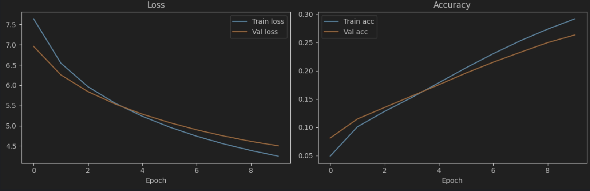

Word2Vec_and_LSTM

Лабораторная работа - пет проект по NLP: предсказание следующего слова в тексте с использованием Word2Vec (реализован с нуля) и двухслойного LSTM.

## 📂 Данные
Исходные текстовые файлы (книги о Гарри Поттере) **не включены** в репозиторий из-за потери этих данных, в случае обнаружения появятся в репозитории. В качестве обучающих данных были все книги Гарри Поттера собранные вместе и обработанные preprocessing.py. 

Ошибка в конце ноутбука Word2Vec_and_LSTM.ipynb возникла из-за того, что первоначально лабораторная работа была написана в Google Colab, это не несет проблем в запуске и работе самого кода.

**Как воспроизвести:**
1. Скачайте любой текст на русском языке и назовите его `Harry_Potter_all.txt`.
2. Запустите скрипт очистки: `python src/preprocessing.py`. Он создаст `Harry_Potter_cleaned.txt`.
3. Запустите ноутбук из папки `notebooks/`.

## 📊 Результаты
*   **Test Accuracy:** `0.2633 (26.33%)`
*   **Test Perplexity:** `90.45`

Графики обучения:
**